# kindling

Living backdrops for the Claude Code desktop app. One mod, `looks`, with eighteen themes that move while Claude works and rest while it waits.

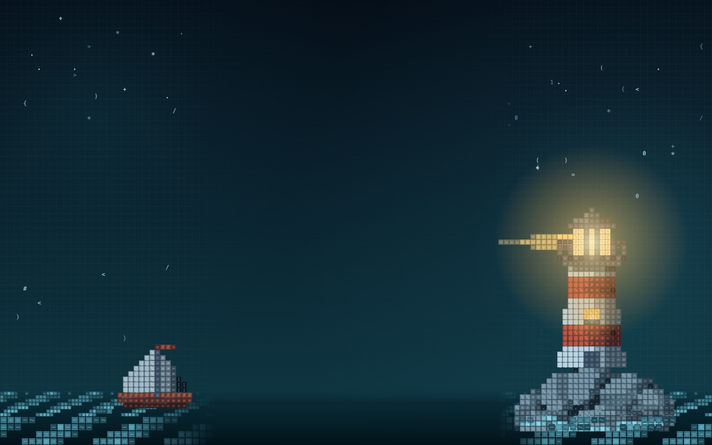

## Install

At the prompt of a terminal session:

```
/plugin install looks --marketplace ArtemKudriaC/kindling
```

Answer `y` to add the marketplace, then pick a scope with Enter.

From a shell:

```
claude plugin install looks --marketplace ArtemKudriaC/kindling
```

In the desktop app: click + next to the prompt box, then Plugins, Add marketplace with `ArtemKudriaC/kindling`, then Add plugin.

## Use

| Command | What it does |
|---|---|
| `/look` | lists the themes and shows the current one |
| `/look <id>` | switches the theme and remembers it |
| `/look set recovery 0..100` | the recovery score that `recovery` draws |
| `/look set garden 0..7` | habits kept this week, for `garden` |

Theme names and command replies are in Russian. Each theme sets the colours, the glass of the panels and a backdrop. The backdrops are drawn in SVG only: no images, no scripts.

## Glyph: wallpapers painted in character tiles

Every object is rasterized into small tiles, one monospace character each, shaded by a density ramp. Things move in whole cells, like terminal animation. Each theme has a light and a dark variant (two times of day of the same place) and follows the app's scheme. Click an object and its tiles scatter.

| Day | Night |
|---|---|
| 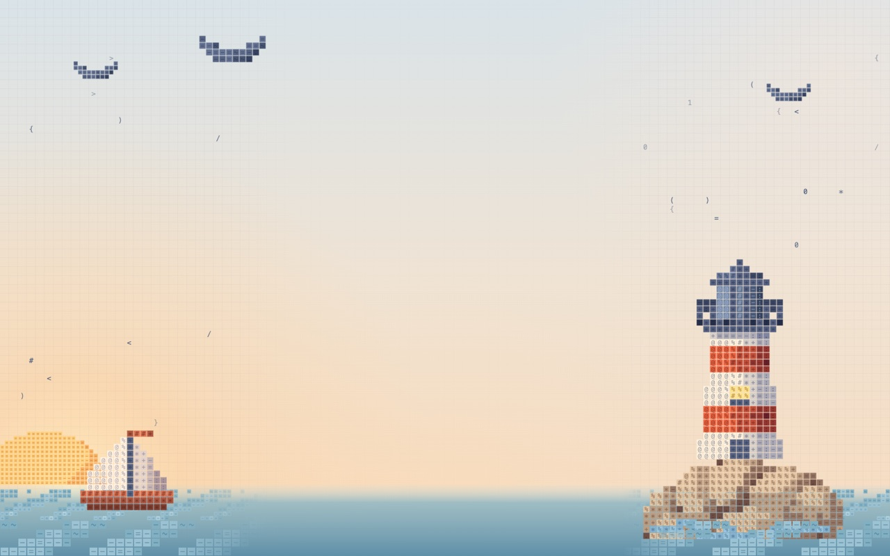 |  |
| **Маяк** `glyph-lighthouse`: a lighthouse, a boat and the sea | the beam sweeps and the boat sails while Claude works |
|  | 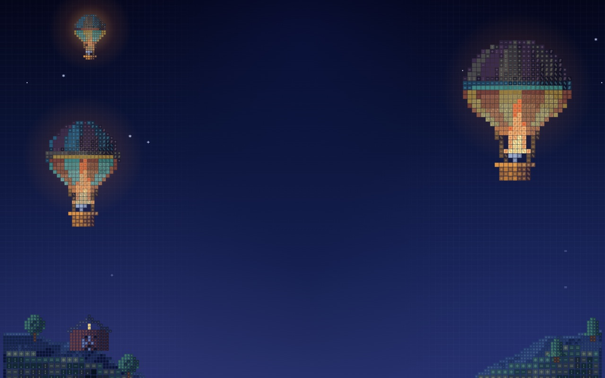 |
| **Шары** `glyph-balloons`: three hot-air balloons over hills | at night they glow from the burners |
| 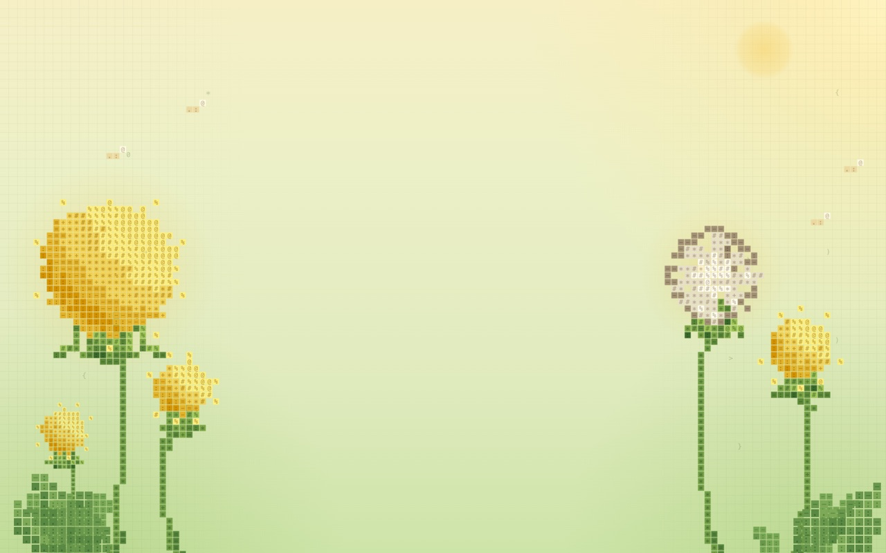 | 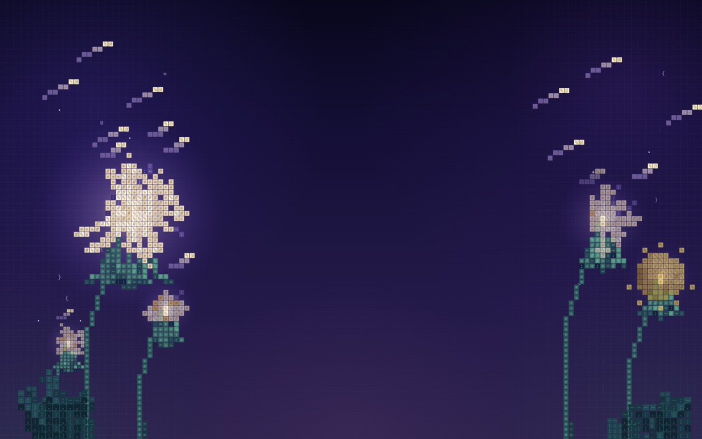 |
| **Одуванчики** `glyph-dandelion`: a meadow seen from low down | at dusk the heads are seed clocks and the wind carries seeds |
|  |  |
| **Поезд** `glyph-train`: a small railway in hill country | signal green, the steam train runs through the tunnel |

## Raster: print dither

A solid pixel mosaic with ordered dither.

| | |
|---|---|
| 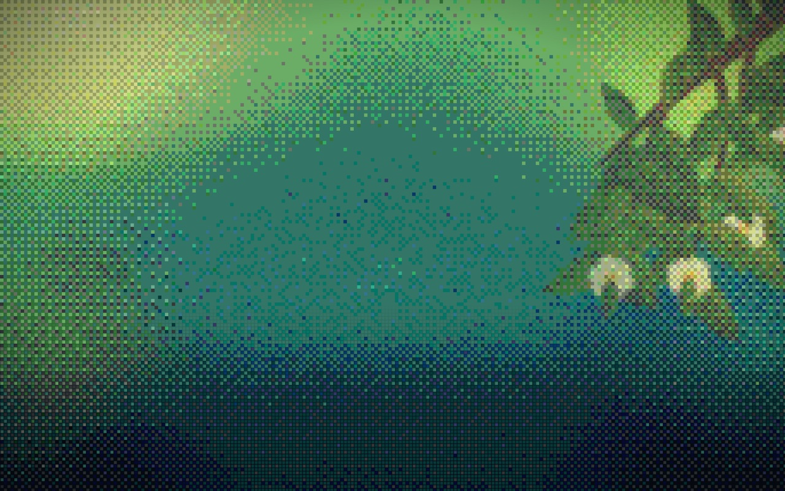 |  |
| **Растр** `raster`: lime and navy fields and a branch | **Растр: IDE** `raster-ide`: IDE colours and curly braces; click near an edge for a pixel wave |
|  | |
| **Растр: Код** `raster-code`: warm colours and a flowering branch; click near an edge for a pixel flower, click the branch to drop petals | |

## Scenes

| | |
|---|---|
|  |  |
| **Костёр** `koster`: embers glow while Claude waits and flare while it works | **Тёмная сторона** `dark-side`: a cloaked figure, the red blade brightens while Claude works |
| 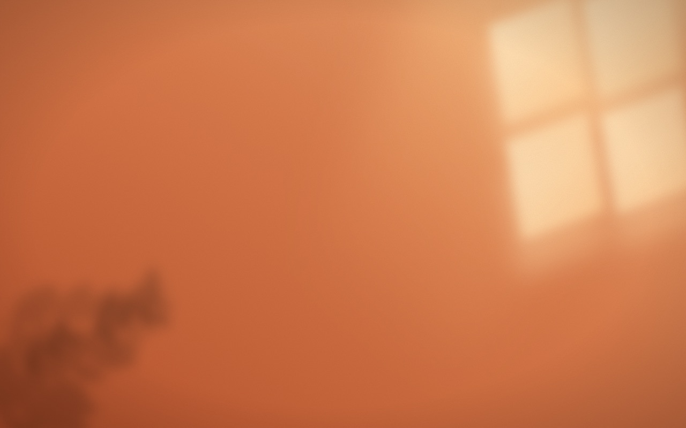 |  |
| **Терракота** `terracotta`: a clay wall, sun patches by day and lamplight in the evening | **Глина** `clay`: warm ivory and clay shapes that come alive while Claude works |
|  | 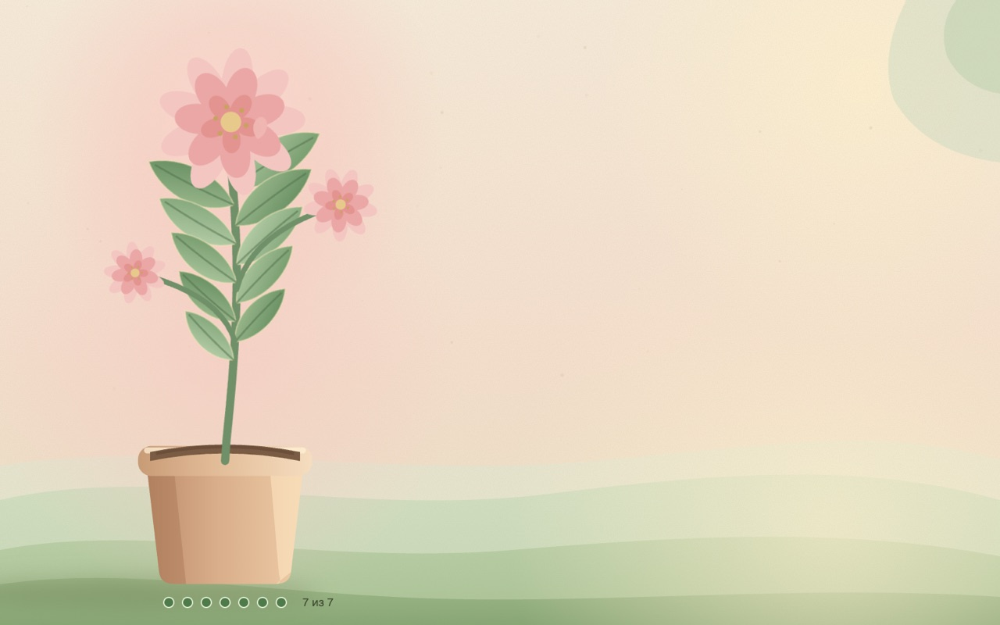 |
| **Рукопись** `manuscript`: parchment, an illuminated initial and a verse a day (Synodal translation) | **Сад привычек** `garden`: a plant that grows with the habits you kept this week |
|  | 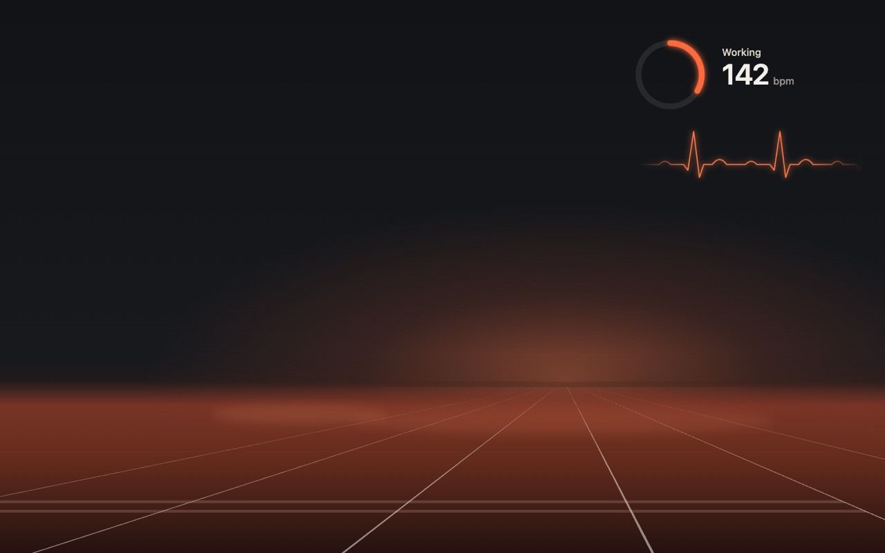 |
| **Восстановление** `recovery`: colour and pulse follow the day's recovery score | **Тренировка** `training`: the track runs while Claude works, a rest timer while it waits |
| 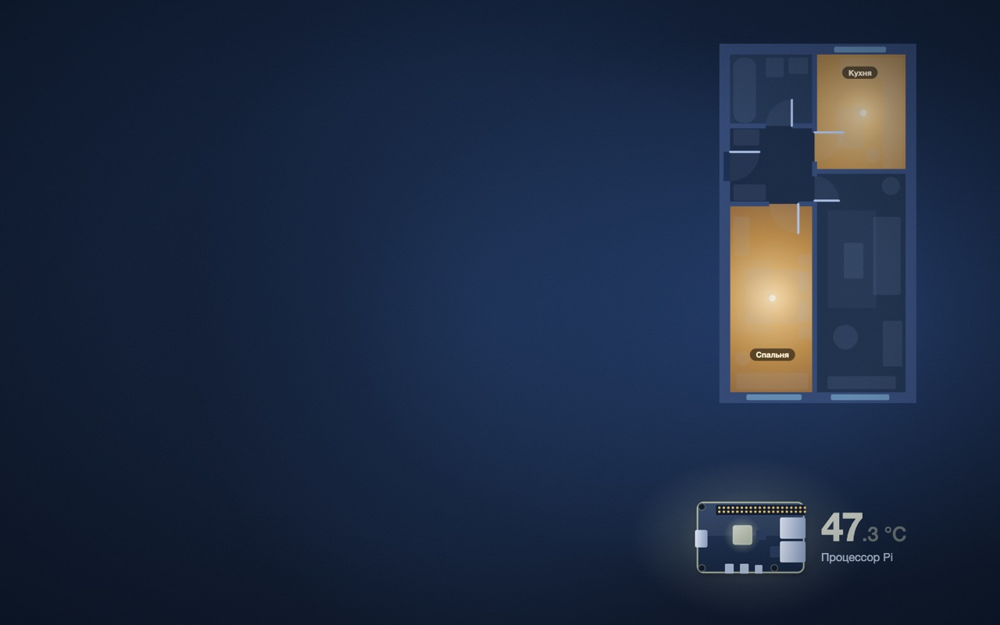 | 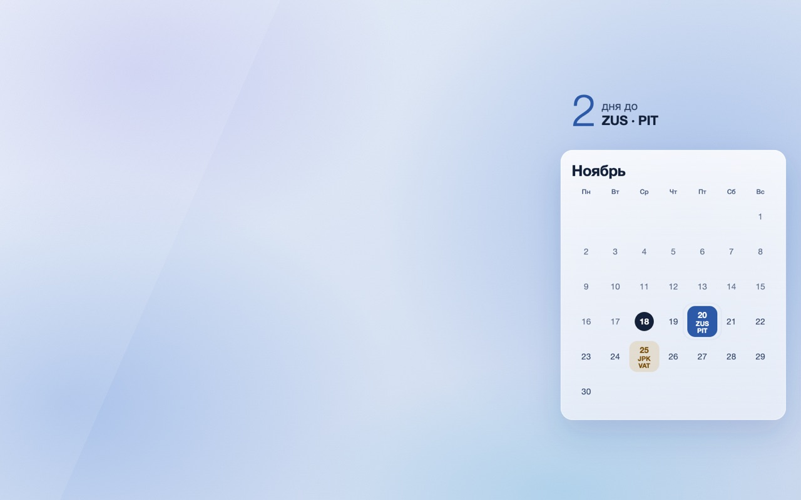 |
| **Умный дом** `home`: a floor plan in thin lines and a Raspberry Pi in the corner | **Конец месяца** `month-end`: a month calendar where Polish tax dates (ZUS, PIT, JPK) surface as they near |
| 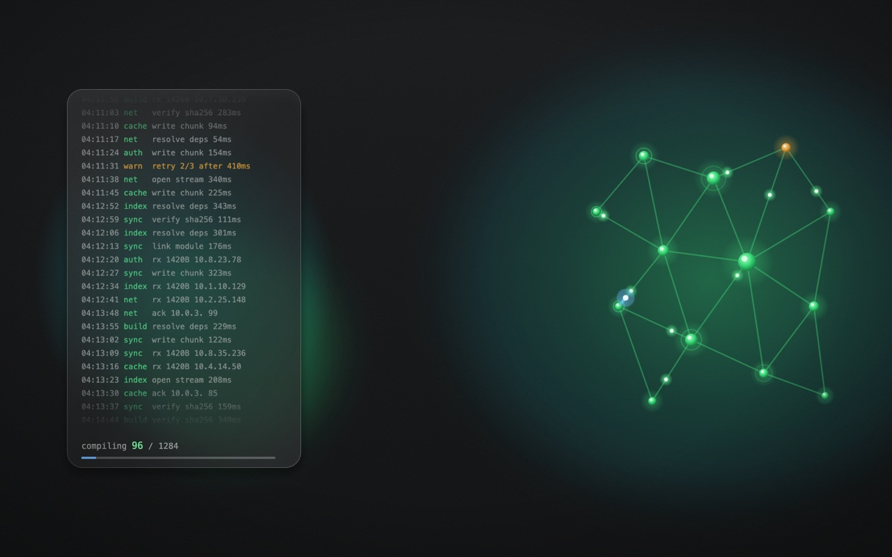 | |
| **Хакер** `hacker`: a green terminal, lines run while Claude works | |

## Develop

```
claude plugin validate .
claude plugin test .
```

Scenes live in `hooks/scenes/`, one pure function per theme that returns an SVG string. Palettes are in `hooks/palettes.ts`; `hooks/register.tsx` wires them to `/look`. The tile rasterizer behind the glyph family is described in [docs/GLYPH-KIT.md](docs/GLYPH-KIT.md).
