# kindling

Living backdrops for the Claude Code desktop app. One mod, `kindling`, with twenty-four themes that move while Claude works and rest while it waits. They draw only in the Code tab of the desktop app: in a terminal or VS Code, `/look` saves the choice and draws nothing.


## Install

At the prompt of a terminal session:

```
/plugin install kindling --marketplace ArtemKudriaC/kindling
```

Answer `y` to add the marketplace, then pick a scope with Enter.

From a shell:

```
claude plugin install kindling --marketplace ArtemKudriaC/kindling
```

In the desktop app: click + next to the prompt box, then Plugins, Add marketplace with `ArtemKudriaC/kindling`, then Add plugin.

To get new themes later, update and restart:

```
claude plugin update kindling@kindling
```

Installed it before 0.5.0, when the plugin was called `looks`? Run `claude plugin uninstall looks@kindling`, then install `kindling` as above. The saved look starts again from Костёр.

A chat keeps the version it started with: other chats show a new theme only after the plugin is updated and they are restarted.

## Use

| Command | What it does |
|---|---|
| `/look` | lists the themes and shows the current one |
| `/look <id>` | switches the theme and remembers it; other open chats running the same copy follow within a few seconds |
| `/look set recovery 0..100` | the recovery score that `recovery` draws |
| `/look set garden 0..7` | habits kept this week, for `garden` |

Theme names and command replies are in Russian. Each theme sets the colours, the glass of the panels and a backdrop. The backdrops are drawn in SVG only: no images, no scripts.

The choice is stored per copy of the mod: a copy run from a development folder keeps its own choice, apart from the installed plugin's.

In a terminal chat `/look` saves the choice and draws nothing: the themes show in the desktop app. A copy where nothing was chosen yet wears Костёр and says so once, in a toast, the first time the app shows it.

A theme belongs to a chat, so the app's New session screen stays plain until the chat starts.

## Glyph: wallpapers painted in character tiles

Every object is rasterized into small tiles, one monospace character each, shaded by a density ramp. Things move in whole cells, like terminal animation. Each theme has a light and a dark variant (two times of day of the same place) and follows the app's scheme. Click an object and its tiles scatter.

| Day | Night |
|---|---|
|  |  |
| **Маяк** `glyph-lighthouse`: a lighthouse, a boat and the sea | the beam sweeps and the boat sails while Claude works |
| 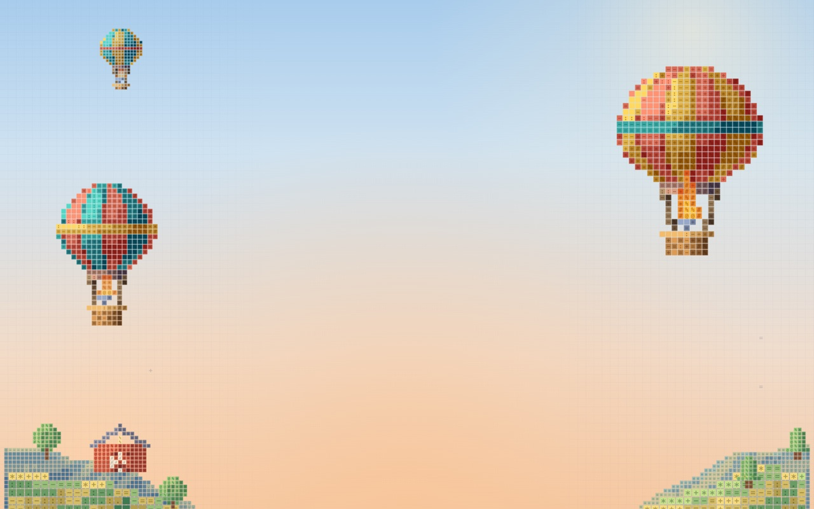 |  |
| **Шары** `glyph-balloons`: three hot-air balloons over hills | at night they glow from the burners |
|  |  |
| **Одуванчики** `glyph-dandelion`: a meadow seen from low down | at dusk the heads are seed clocks and the wind carries seeds |
| 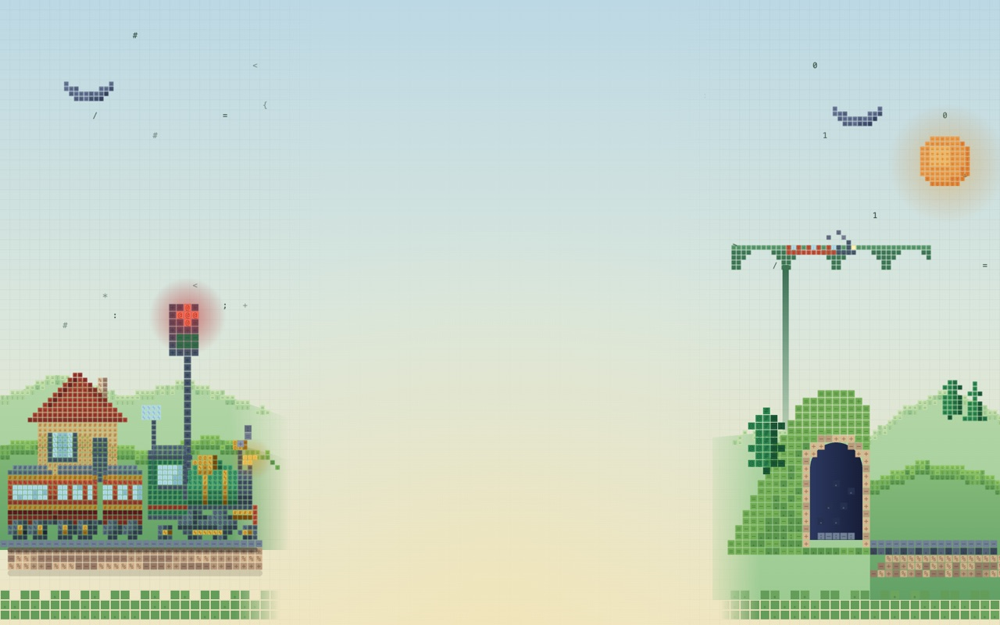 | 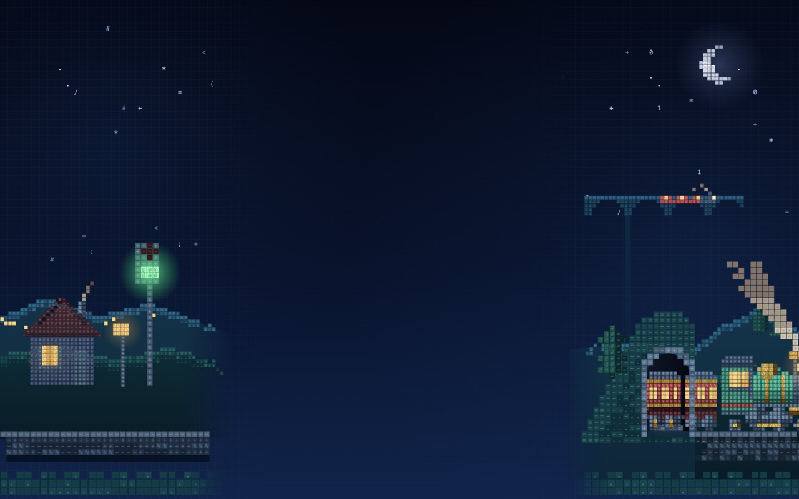 |
| **Поезд** `glyph-train`: a small railway in hill country | signal green, the steam train runs through the tunnel |

## Spark: a backdrop about AI

A spark of lettered tiles in the right margin, a small creature beside the input, a faint grid and a few code glyphs at the edges, drawn with the same tile kit as Glyph. Everything busy sits clear of the chat column. It comes as two separate looks that set the app's scheme themselves: Тлеющее ядро is always dark, Слоновая кость always light. While Claude works, light runs out along the spark's rays and the creature steps in place; at rest the creature only blinks.

| Light | Dark |
|---|---|
| 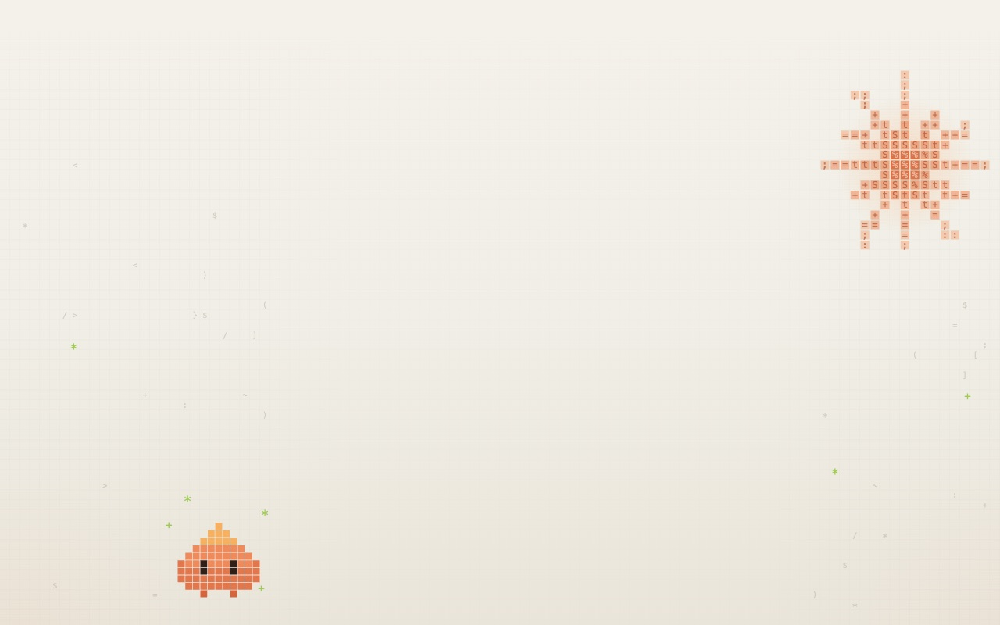 | 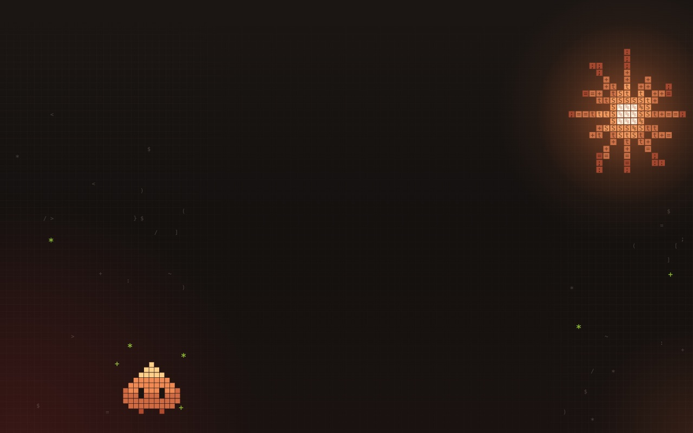 |
| **Слоновая кость** `ivory`: terracotta and lime on ivory | **Тлеющее ядро** `ember-core`: red, orange and acid green on warm black |

## Stipple: a painting in dabs

A wooded slope over a still lake, built from short strokes of paint: three hues on every crown, vertical dabs in the sky, horizontal ones on the water. It follows the app's scheme: a warm morning in blue and green, or a moonlit night all in blue. Click the water for rings and a jumping fish, click the boat to rock it.

| Morning | Night |
|---|---|
| 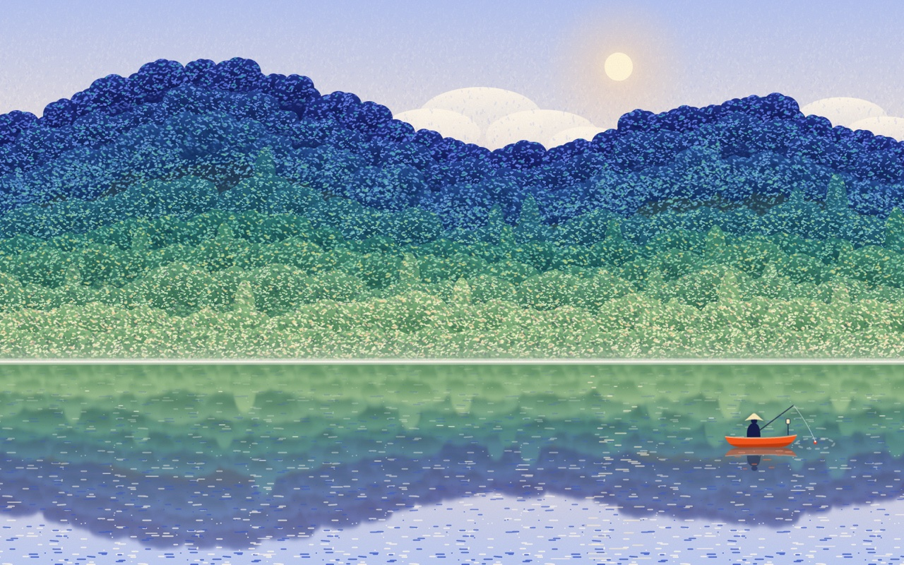 | 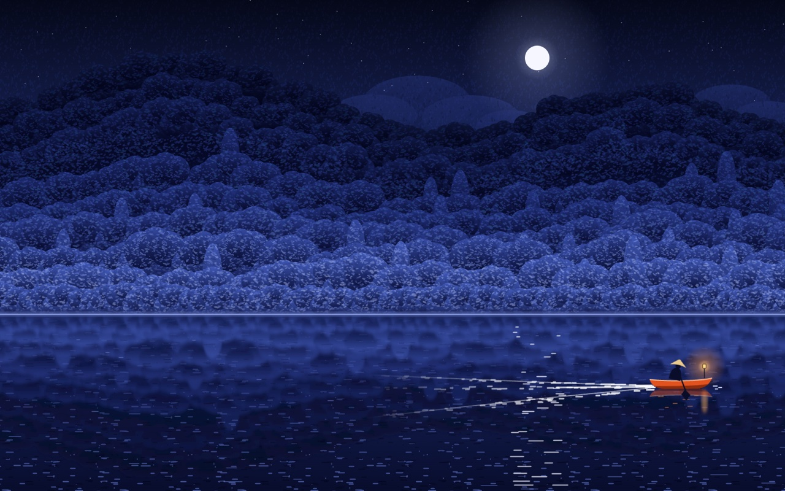 |
| **Озеро** `stipple-lake`: a fisherman waits in an orange boat | while Claude works, the boat is paddled across the lake and pulls a wake |

## Gouache: a November evening

A lone maple on a hill, painted in flat gouache shapes. It sheds its leaves by a street lamp and a bench with a cat; to the left a lighthouse stands on its cliff above a bay, with the keeper's house and a footpath down through tall grass; far off there is a village. It follows the app's scheme: a pale foggy day, or a starlit night with a crescent moon and lit windows. Click the crown for a flurry of leaves, the lamp to make it flicker, the bench to startle the cat, the moon for a ring of light and, at night, a shooting star.

| Day | Night |
|---|---|
| 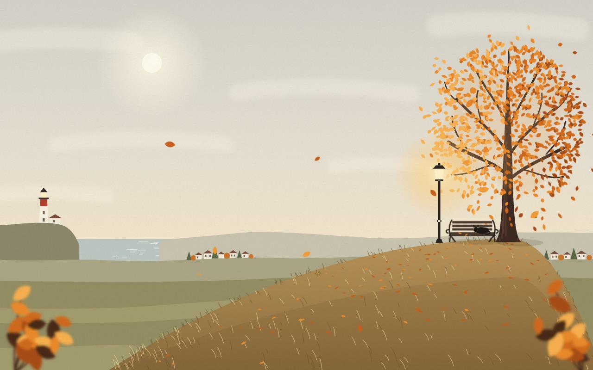 | 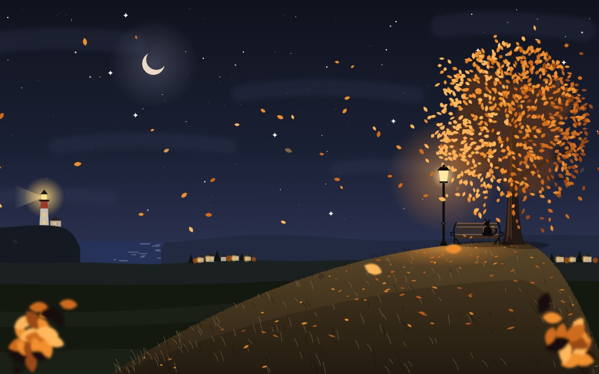 |
| **Осень** `gouache-autumn`: leaves come down one by one, on both sides of the chat | while Claude works, the wind carries the leaves across the whole picture |

## Sumi-e: Japan of the shoguns

Ink on old paper, in the manner of shogun-era painting. A castle keep stands on its hill under a red sun, with two war banners and ink pines; far mountains fade into mist, geese cross the sky, and an old cherry tree leans in from the right while a blossoming branch reaches in at the top. It follows the app's scheme: pale paper by day, or dark paper at night with the moon and lit castle windows.

| Day | Night |
|---|---|
| 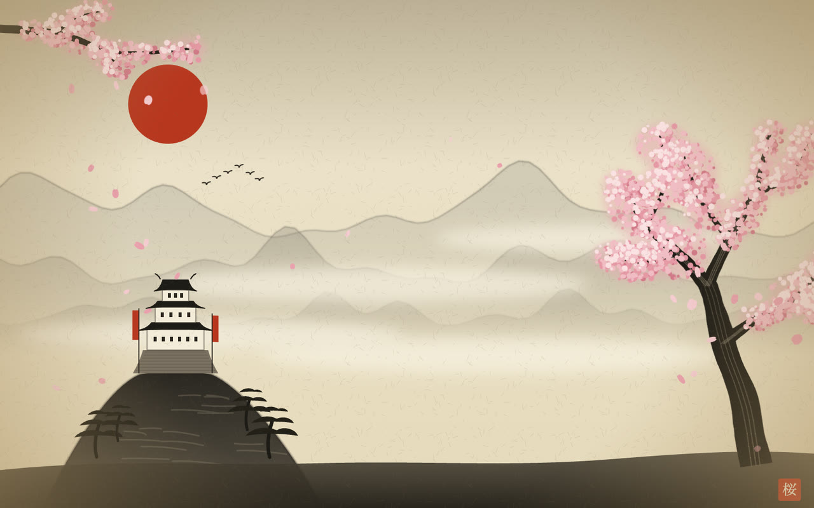 | 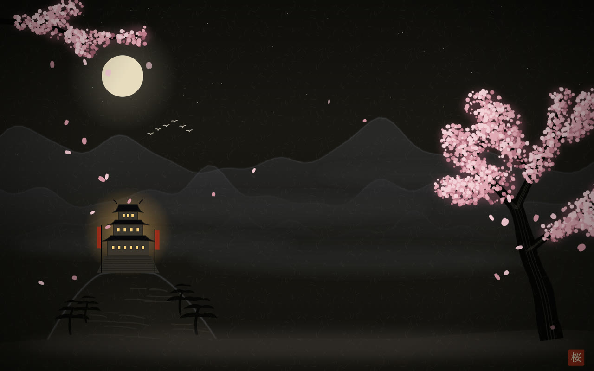 |
| **Сакура** `sakura`: petals drift down on both sides of the chat | while Claude works, the wind carries the petals across, the tree sways and the banners fly |

## Ukiyo-e: an evening bay in woodblock print

Flat colour inside black key-block lines that swell and taper like a cut line, colour graded at the top of the sky, at the horizon and along the lower edge of the mist, wood grain and paper fibres: a woodblock print of the Edo period, drawn from scratch. On the left a vermilion gate stands in the water and the sun sets between its pillars, a fisherman sits in his skiff below it, and a cartouche in the corner holds the print's title and a seal. On the right a snow mountain rises out of a band of mist, an old pine leans out from a rock beside a stone lantern, a boat lies off the headland and a wave breaks below the rock. It follows the app's scheme: an evening print by day, or a night print with the moon, the lit lantern and lamps on the boats.

| Day | Night |
|---|---|
| 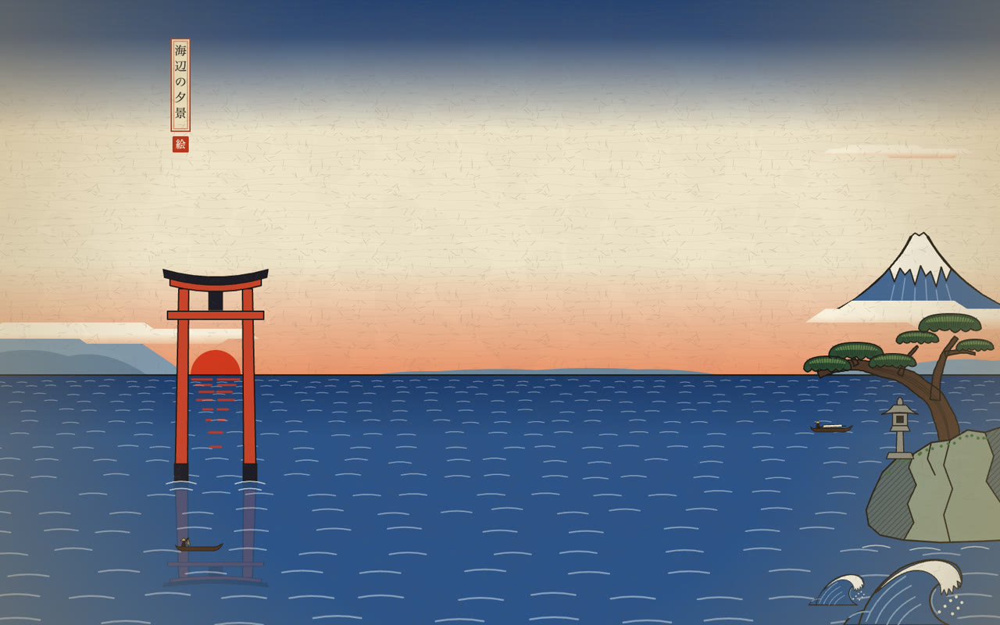 | 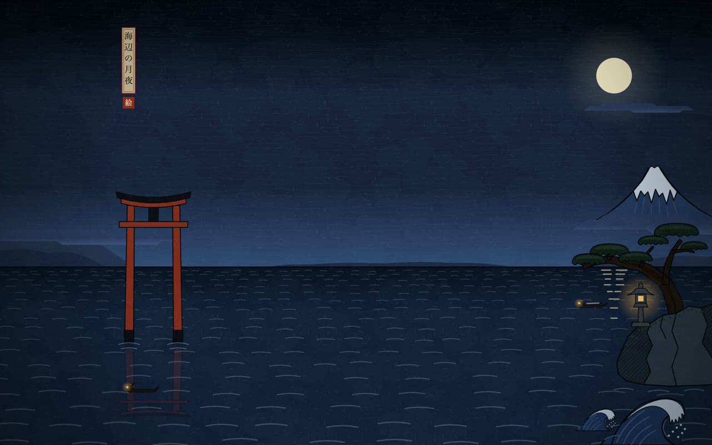 |
| **Укиё-э** `ukiyo-e`: a slow swell, the boats rock, the sail is stowed | while Claude works, the wind rises: mist drifts across the gate, the fisherman casts his net, the sail is set, more crests break and throw spray |

## Raster: print dither

A solid pixel mosaic with ordered dither.

| | |
|---|---|
|  |  |
| **Растр** `raster`: lime and navy fields and a branch | **Растр: IDE** `raster-ide`: IDE colours and curly braces; click near an edge for a pixel wave |
| 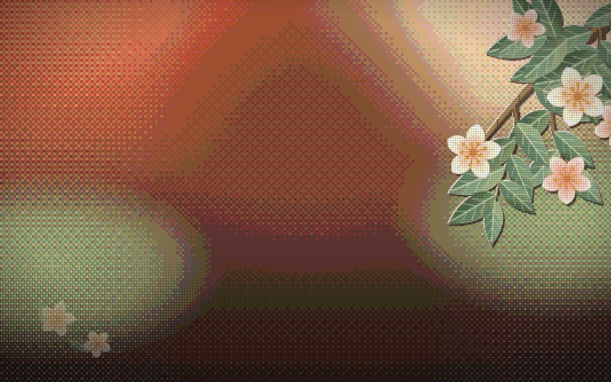 | |
| **Растр: Код** `raster-code`: warm colours and a flowering branch; click near an edge for a pixel flower, click the branch to drop petals | |

## Scenes

| | |
|---|---|
| 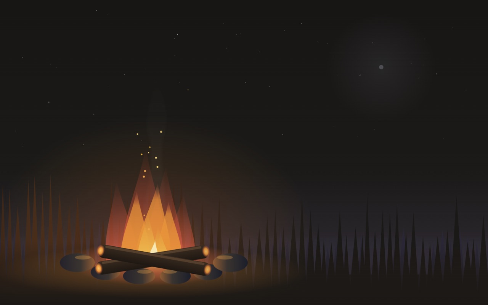 | 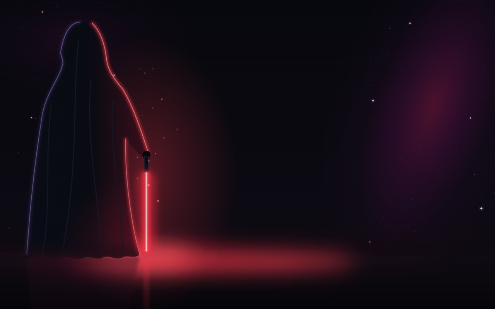 |
| **Костёр** `koster`: embers glow while Claude waits and flare while it works | **Тёмная сторона** `dark-side`: a cloaked figure, the red blade brightens while Claude works |
|  | 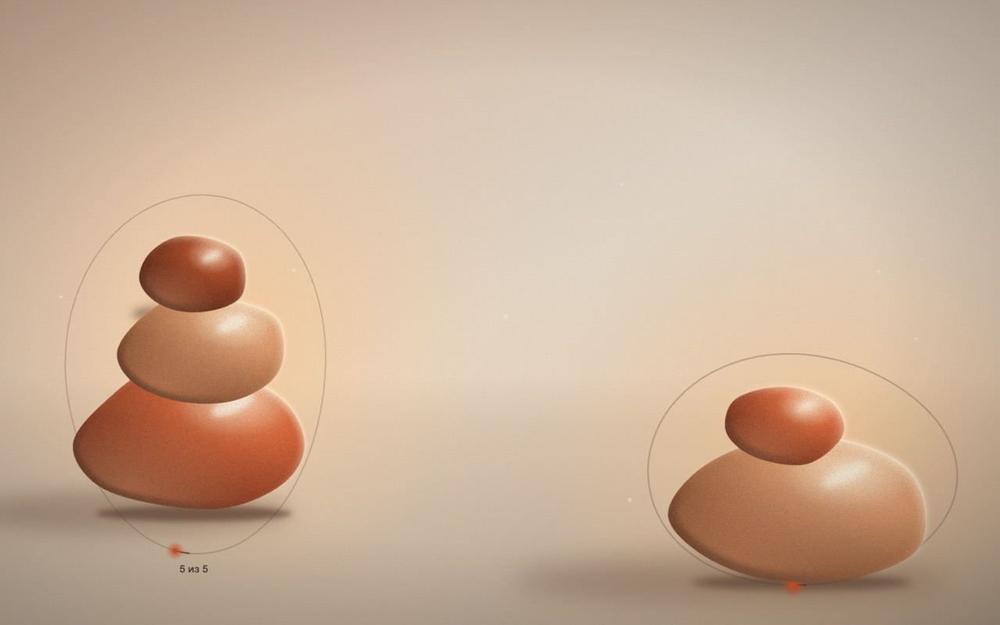 |
| **Терракота** `terracotta`: a clay wall, sun patches by day and lamplight in the evening | **Глина** `clay`: warm ivory and clay shapes that come alive while Claude works |
| 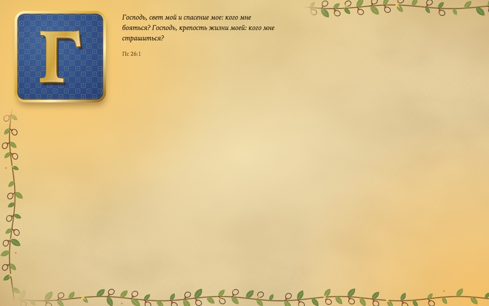 |  |
| **Рукопись** `manuscript`: parchment, an illuminated initial and a verse a day (Synodal translation) | **Сад привычек** `garden`: a plant that grows with the habits you kept this week |
| 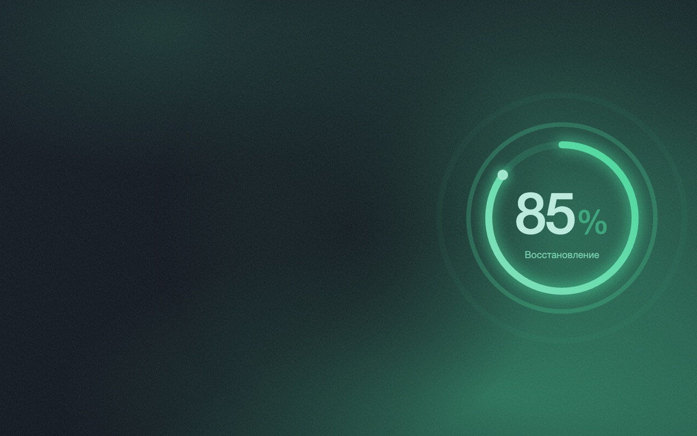 |  |
| **Восстановление** `recovery`: colour and pulse follow the day's recovery score | **Тренировка** `training`: the track runs while Claude works, a rest timer while it waits |
|  |  |
| **Умный дом** `home`: a floor plan in thin lines and a Raspberry Pi in the corner | **Конец месяца** `month-end`: a month calendar where Polish tax dates (ZUS, PIT, JPK) surface as they near |
|  | |
| **Хакер** `hacker`: a green terminal, lines run while Claude works | |

## What it reads and sends

Nothing leaves your computer. The mod makes no network calls, runs no programs and reads no files, keys or environment. `http://www.w3.org/2000/svg` in the scenes is the SVG namespace inside the drawings, not an address it contacts.

Calls it makes, all Claude Code's own:

- `theme.set` puts the chosen look on the window: its colours and its backdrop scene.
- `store.get` and `store.set` remember which look you chose and whether the welcome note was shown. The store stays on this machine.
- `command.register` adds `/look`. `ui.resolve` hands the scene to the backdrop. `ui.status` and `ui.toast` show a short line: why a look could not be drawn, or once which look you are wearing. `clock.every` checks every few seconds whether another chat picked a new look; `clock.after` ends Костёр's burst.

Hooks:

- `session.start` registers `/look` and puts on the saved look.
- `command.run` answers `/look` only and lets every other command through.
- `session.attach` shows the welcome note once, in the desktop app, while no look has been chosen yet.
- `turn.start` and `turn.complete` switch a live scene between working and waiting. They read only that a turn started or ended; `turn.start` also checks the store for a look chosen in another chat.
- `session.append` reads Claude's replies for the word "merged", which makes Костёр flare. The text is not kept or sent.
- `ui.render` on `Backdrop` draws the scene; it leaves other plugins' backdrops alone.

`hooks/make-colors.js` is the colour kit that Claude Code's plugin-authoring skill hands out, copied unchanged. It turns a palette into a theme and checks text contrast; its long hexadecimal strings are colour ramps.

## Develop

```
claude plugin validate .
claude plugin test .
```

Scenes live in `hooks/scenes/`, one pure function per theme that returns an SVG string. Palettes are in `hooks/palettes.ts`; `hooks/register.tsx` wires them to `/look`. The tile rasterizer behind the glyph family is described in [docs/GLYPH-KIT.md](docs/GLYPH-KIT.md).
